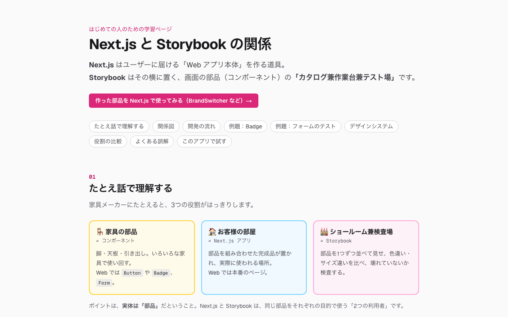
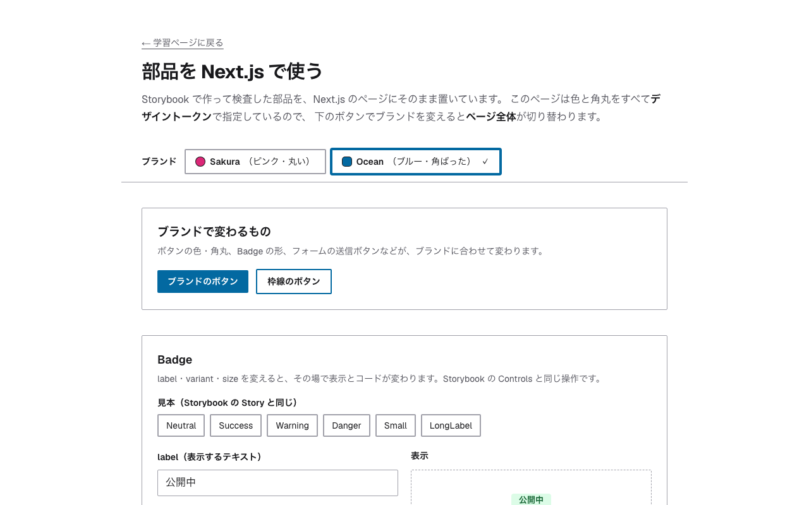
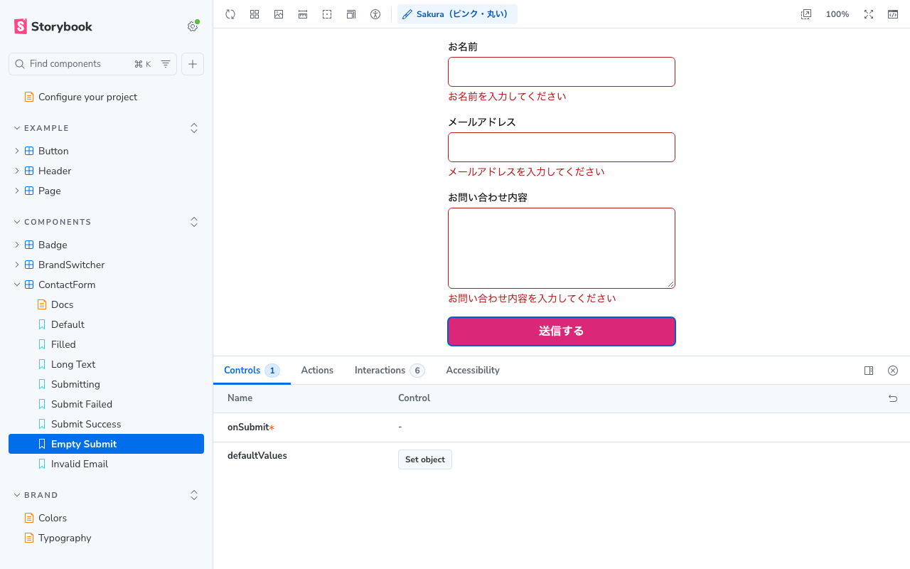
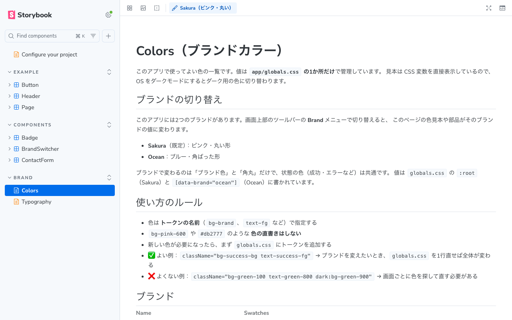

# Next.js × Storybook 学習デモ

Next.js（App Router）と Storybook 10 を組み合わせて、**「部品を Storybook で作って検査し、Next.js のページで使う」** 流れを体験できる学習用プロジェクトです。

デザイントークンによるマルチブランド（Sakura / Ocean）切り替え、ダークモード、Interaction test、アクセシビリティ検査までを小さなサンプルで扱います。



## できること

| 画面 | 内容 |
| --- | --- |
| `/`（学習ページ） | Next.js と Storybook の関係を、たとえ話・関係図・例題コードで解説 |
| `/playground` | Storybook で作った部品（Badge / ContactForm / BrandSwitcher など）を Next.js のページで実際に動かす。props をその場で変えて試せる |
| Storybook | 各部品の Story、Interaction test、a11y チェック、ブランドカラー・タイポグラフィの見本ページ |

### Playground（Ocean ブランドに切り替えた状態）

ブランドを切り替えると、色と角丸がデザイントークン経由でページ全体に反映されます。



### Storybook

| ContactForm の Interaction test | ブランドカラーの見本 |
| --- | --- |
|  |  |

## 技術スタック

- [Next.js](https://nextjs.org) 16（App Router / Turbopack）
- React 19
- [Storybook](https://storybook.js.org) 10（`@storybook/nextjs-vite`）
  - `@storybook/addon-docs` / `@storybook/addon-a11y` / `@storybook/addon-vitest`
- Tailwind CSS 4（Next.js は `@tailwindcss/turbopack`、Storybook は `@tailwindcss/vite`）
- Vitest 4 + Playwright（ブラウザモードで Story をテスト）
- TypeScript

## はじめかた

Node.js 22 以上を推奨します（Node.js 24 で動作確認）。

```bash
npm install
```

### Next.js アプリ

```bash
npm run dev
```

http://localhost:3000 を開きます。

### Storybook

```bash
npm run storybook
```

http://localhost:6006 を開きます。ツールバーの **Brand** メニューで Sakura / Ocean を切り替えられます。

### テスト

```bash
npx playwright install chromium   # 初回のみ
npm test
```

すべての Story を **ブランド（Sakura / Ocean）× カラースキーム（ライト / ダーク）** の 4 通りで実行します。`play` 関数による Interaction test に加え、`@storybook/addon-a11y` の違反（コントラスト不足など）があるとテストが失敗します。

## npm scripts

| コマンド | 内容 |
| --- | --- |
| `npm run dev` | Next.js 開発サーバ（ポート 3000） |
| `npm run build` / `npm start` | Next.js の本番ビルド / 起動 |
| `npm run storybook` | Storybook 開発サーバ（ポート 6006） |
| `npm run build-storybook` | Storybook の静的ビルド（`storybook-static/`） |
| `npm test` | Vitest で全 Story をテスト |
| `npm run test:watch` | テストをウォッチモードで実行 |
| `npm run lint` | ESLint |

## ディレクトリ構成

```
app/
  page.tsx            学習ページ（/）
  playground/         部品を Next.js で使うページ（/playground）
  globals.css         デザイントークン（ブランド・ダークモードの色、角丸）
  brand-switcher.tsx  BrandSwitcher を <html data-brand> につなぐクライアント部品
components/
  Badge/              ラベル表示の部品と Story
  BrandSwitcher/      ブランド切り替えボタンと Story
  ContactForm/        お問い合わせフォームと Story（Interaction test あり）
design-system/        Storybook のブランド見本ページ（Colors / Typography）
stories/              Storybook 初期サンプル（Button / Header / Page）
.storybook/           Storybook 設定（Tailwind・Brand ツールバー・a11y）
vitest.config.mts     ブランド × ライト/ダークのテスト設定
```

## デザイントークンとマルチブランド

色と角丸は `app/globals.css` の CSS 変数で 1 か所に定義し、Tailwind の `@theme inline` でクラス名（`bg-brand`、`text-fg`、`bg-success-bg` など）に対応させています。

- `<html data-brand="ocean">` のように属性を切り替えるだけで、ブランドの見た目が変わります
- `prefers-color-scheme: dark` でダーク用の値に自動で切り替わります
- 部品側は色を直書きせず、トークン名だけで指定します

```tsx
// ✅ トークンの名前で指定（ブランドもダークも自動で切り替わる）
<span className="bg-success-bg text-success-fg">公開中</span>
```

## ライセンス

[MIT](LICENSE)
